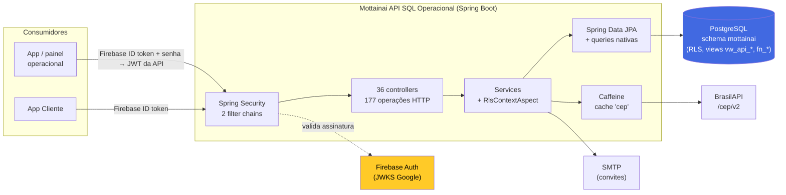
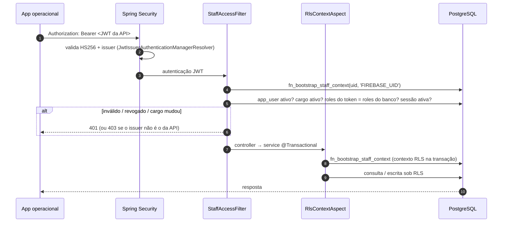
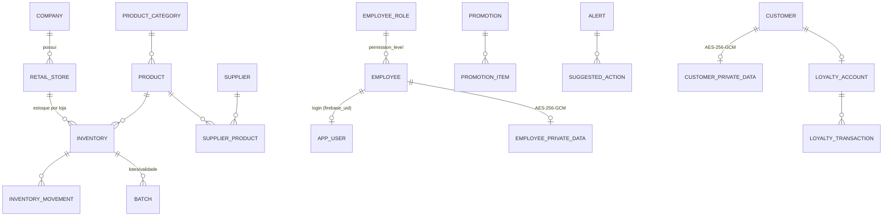
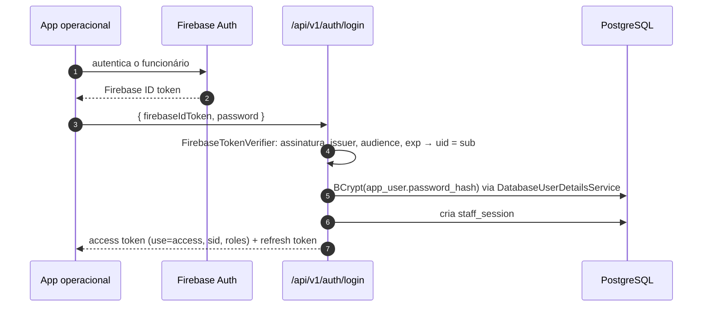
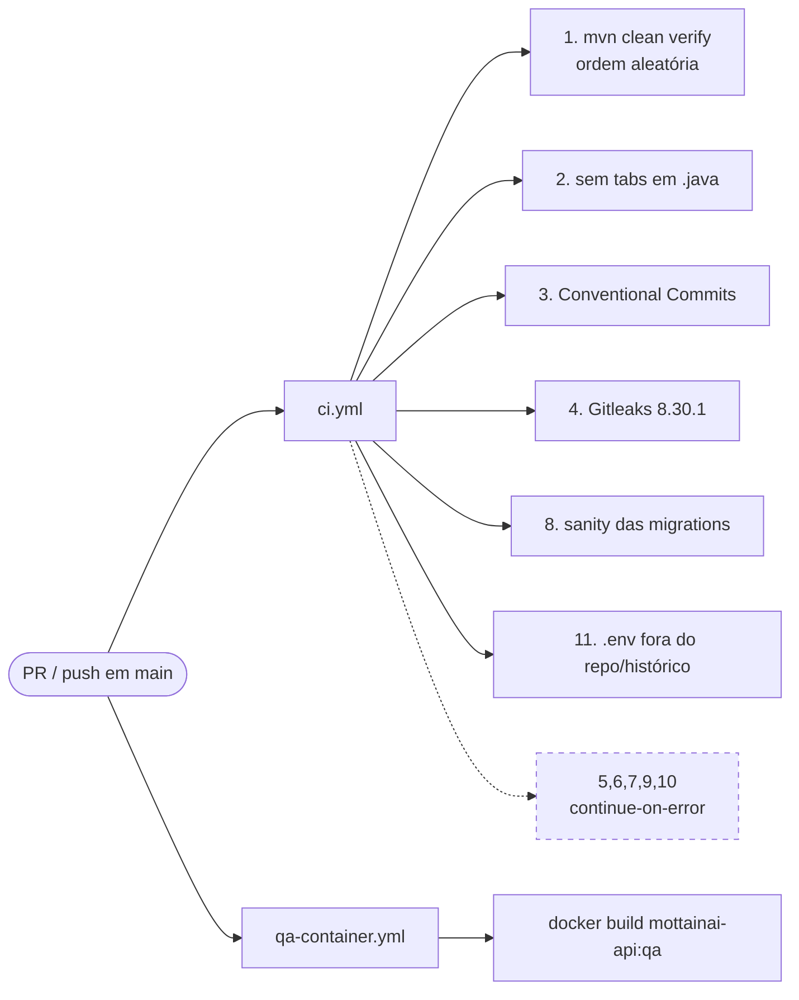

<div align="center">

# Mottainai API SQL Operacional

**API REST do Mottainai para a operação de lojas: funcionários, empresas, lojas, catálogo, estoque, compras, promoções, alertas e reposição**

*Spring Boot sobre um PostgreSQL operacional protegido por RLS, com login de funcionários via Firebase + JWT próprio e dados pessoais em AES-256-GCM.*

<br/>

[](pom.xml)
[](pom.xml)
[](src/main/resources/application.yaml)
[](docs/OPERATIONAL_FIREBASE_AUTH.md)

[](.mvn/wrapper/maven-wrapper.properties)
[](pom.xml)
[](Dockerfile)
[](.github/workflows/ci.yml)

<br/>

[Visão geral](#1-visão-geral) •
[Arquitetura](#2-arquitetura) •
[Tecnologias](#3-tecnologias) •
[Endpoints](#5-módulos-e-endpoints) •
[Segurança](#7-segurança) •
[Configuração](#8-configuração) •
[Executar](#9-como-executar) •
[Riscos](#11-segurança-e-operação)

</div>

---

## 1. Visão geral

O **Mottainai** (もったいない, *"que desperdício"*) é um sistema de gestão preditiva de estoque para pequenos e médios varejos, distribuído em vários repositórios da organização [Mottainai-One](https://github.com/Mottainai-One). Este repositório contém a **API operacional**: o backend que os apps e o painel de funcionários usam para cadastrar e operar empresas, lojas, produtos, estoque, compras, recebimentos, promoções, alertas e reposição.

| | Característica | Como aparece no código (`main`) |
|---|---|---|
| **1** | **Banco é externo** | `spring.jpa.hibernate.ddl-auto: validate` e `spring.flyway.enabled: false`. A API **não cria** o schema, só valida o mapeamento. |
| **2** | **Isolamento por RLS** | Toda transação em `service..*` passa por `RlsContextAspect`, que chama `mottainai.fn_bootstrap_staff_context` antes de liberar a operação. |
| **3** | **Identidade via Firebase, sessão via API** | `POST /api/v1/auth/login` recebe Firebase ID token + senha da API e devolve um JWT HS256 próprio, vinculado a uma sessão revogável. |
| **4** | **Permissão vem do banco** | Authorities derivadas de `employee_role.permission_level` (`StaffRoleAuthorities`), nunca de claims do Firebase. |
| **5** | **PII protegida** | Tokens SHA-256 nas tabelas principais, HMAC para busca de CPF e payload AES-256-GCM em tabelas `*_private_data`. |
| **6** | **Rotas de cliente ainda coexistem** | `/api/v1/client/**`, `/api/v1/customer-catalog/**` e `/api/v1/customers/**` continuam aqui; o README do repositório as trata como transitórias. |

> [!NOTE]
> O nome do artefato Maven é `com.institutojf:mottainai:0.0.1-SNAPSHOT` e o pacote raiz é `com.institutojf.mottainai`. O título do OpenAPI é "Mottainai API" com licença "Academic project" (`config/OpenApiConfig.java`).

---

## 2. Arquitetura

### Visão de contexto



### Camadas do código

| Camada | Pacote | Conteúdo observado |
|---|---|---|
| Entrada | `controller/` | 36 controllers REST (`@RequestMapping` sob `/api/v1`) |
| Contrato OpenAPI | `controller/swagger/` | 35 interfaces `*ControllerApi` com anotações springdoc |
| DTOs | `dto/request`, `dto/response` | 72 requests e 53 responses |
| Mapeamento | `mapper/` | 13 mappers manuais (sem MapStruct) |
| Regras | `service/` | 48 classes, incluindo `RlsContextService`/`RlsContextAspect`, `BrasilApiClient`, `IdempotencyHash` |
| Persistência | `repository/`, `model/` | 47 repositórios, 42 entidades `@Table`, 15 enums |
| Segurança | `security/` | `SecurityConfig`, `StaffAccessFilter`, `JwtService`, `FirebaseTokenVerifier`, criptografia de staff/cliente |
| Erros | `handler/`, `exception/` | `GlobalExceptionHandler` + 6 exceções de negócio |
| Config | `config/` | Cache, OpenAPI, propriedades de senha, staff e cliente |

### Fluxo de uma requisição operacional



---

## 3. Tecnologias

<table>
<tr>
<td align="center" width="140"><br/><b>Java 21</b><br/><sub><code>java.version</code><br/>no <code>pom.xml</code></sub></td>
<td align="center" width="140"><br/><b>Spring Boot 4.0.0</b><br/><sub>WebMVC, Data JPA,<br/>Validation, Actuator</sub></td>
<td align="center" width="140"><br/><b>Spring Security</b><br/><sub>OAuth2 Resource Server<br/>(JWT HS256 + Firebase)</sub></td>
<td align="center" width="140"><br/><b>PostgreSQL</b><br/><sub>driver JDBC<br/>schema <code>mottainai</code></sub></td>
</tr>
<tr>
<td align="center" width="140"><br/><b>Firebase Auth</b><br/><sub>ID token validado<br/>via JWKS do Google</sub></td>
<td align="center" width="140"><br/><b>springdoc 3.0.3</b><br/><sub>Swagger UI<br/>e <code>/api-docs</code></sub></td>
<td align="center" width="140"><br/><b>Maven 3.9.16</b><br/><sub>via Maven Wrapper<br/>3.3.4</sub></td>
<td align="center" width="140"><br/><b>Docker</b><br/><sub>build multi-stage<br/>Temurin 21</sub></td>
</tr>
<tr>
<td align="center" width="140"><br/><b>Flyway</b><br/><sub>dependência presente,<br/><b>desativado</b></sub></td>
<td align="center" width="140"><br/><b>Hibernate</b><br/><sub><code>ddl-auto: validate</code></sub></td>
<td align="center" width="140"><br/><b>JUnit 5 + Mockito</b><br/><sub>285 métodos <code>@Test</code></sub></td>
<td align="center" width="140"><br/><b>GitHub Actions</b><br/><sub><code>ci.yml</code> e<br/><code>qa-container.yml</code></sub></td>
</tr>
</table>

### Dependências relevantes (`pom.xml`)

| Dependência | Versão observada | Uso |
|---|---|---|
| `spring-boot-starter-parent` | `4.0.0` | BOM do projeto |
| `spring-cloud-dependencies` | `2025.1.2` | BOM importado para `spring-cloud-starter-openfeign` |
| `springdoc-openapi-starter-webmvc-ui` | `3.0.3` | OpenAPI/Swagger |
| `spring-boot-starter-mail` | `4.0.0` (fixada explicitamente) | Convites de funcionários e recuperação de cliente |
| `spring-security-test` | `7.1.0` (fixada explicitamente, `test`) | Testes de segurança |
| `caffeine` | gerenciada pelo BOM | Cache em memória (TTL 10 min, 10 mil entradas) |
| `lombok` | gerenciada pelo BOM | Annotation processor |
| `postgresql`, `flyway-database-postgresql` | gerenciadas pelo BOM | Driver e suporte Flyway |

> [!NOTE]
> `spring-cloud-starter-openfeign` está declarado, mas **não há uso de Feign** no código (`@EnableFeignClients`/`@FeignClient` não encontrados). A BrasilAPI é consumida com `RestClient` em `service/BrasilApiClient.java`.

---

## 4. Estrutura do repositório

```text
Mottainai-Api-SQL-Operacional/
├── .github/workflows/
│   ├── ci.yml                         # 11 jobs: build/testes, estilo, commits, gitleaks, etc.
│   └── qa-container.yml               # docker build da imagem de QA
├── .mvn/wrapper/maven-wrapper.properties
├── docs/
│   ├── CUSTOMER_MOBILE_API.md         # rotas do app Cliente (Firebase)
│   ├── OPERATIONAL_FIREBASE_AUTH.md   # login operacional Firebase + senha da API
│   ├── PROTECTED_CUSTOMER_CONTRACT.md # contrato de PII de cliente
│   ├── PROTECTED_SCHEMA_TESTS.md      # evidências de schema protegido
│   └── STAFF_AES_GCM_SCHEMA_CONTRACT.md # contrato AES-256-GCM de funcionários
├── src/main/java/com/institutojf/mottainai/
│   ├── config/  controller/  controller/swagger/  dto/  exception/
│   ├── handler/ mapper/      model/              repository/
│   ├── security/ service/
│   └── MottainaiApplication.java
├── src/main/resources/
│   ├── application.yaml               # config base (lê .env opcional)
│   ├── application-local.yaml         # flyway desativado
│   ├── application-qa.yaml            # SMTP apontando para mailpit:1025
│   └── db/migration/V1..V12__*.sql    # migrations legadas (Flyway desligado)
├── src/test/java/...                  # 66 arquivos de teste
├── API_DOCUMENTATION_COMPLETA.md      # doc longa (desatualizada, ver seção 11)
├── IMPLEMENTACAO_COMPLETA.md          # doc técnica (contagens desatualizadas)
├── Dockerfile  .dockerignore  .env.example
├── mvnw  mvnw.cmd  pom.xml
└── README.md
```

No total, `git ls-files` lista **493 arquivos** no commit analisado.

---

## 5. Módulos e endpoints

Contagem extraída diretamente das anotações `@Get/Post/Put/Patch/DeleteMapping` dos controllers: **36 controllers, 177 operações**. O OpenAPI em execução (`/api-docs`) é a referência para corpos, parâmetros e respostas.

### Operacional

| Módulo | Base path | Ops | Destaques |
|---|---|:---:|---|
| Autenticação | `/api/v1/auth` | 7 | `login`, `refresh`, `logout`, `password` (troca), `password-reset` e `password-reset/validate` (conclusão de convite), `profile` |
| Funcionários | `/api/v1/employees`, `/employees-store`, `/employees-company` | 10 | CRUD, `status`, `invite`, `shifts`, `cancel-request` |
| Auditoria de funcionário | `/api/v1/employees/{id}/audit-logs` | 1 | somente `ADMINISTRATOR` |
| Cargos | `/api/v1/employee-roles` | 2 | leitura (`ADMINISTRATOR`, `MANAGER`) |
| Empresas | `/api/v1/companies` | 5 | classe inteira `ADMINISTRATOR` |
| Lojas | `/api/v1/stores` | 6 | CRUD + `status` |
| Endereços | `/api/v1/addresses` | 4 | criar, listar, obter, atualizar |
| CEP | `/api/v1/cep/{cep}` | 1 | **público**, BrasilAPI com cache |
| Planos de assinatura | `/api/v1/subscription-plans` | 5 | CRUD |
| Perfis fiscais | `/api/v1/tax-profiles` | 5 | ver divergência de path no PUT (seção 11) |
| Categorias | `/api/v1/product-categories` | 5 | CRUD |
| Produtos | `/api/v1/products` | 17 | CRUD, `barcode/{barcode}`, `status`, preços por loja, `prices/batch`, vínculo com fornecedores, histórico de cadastro e de preço |
| Fornecedores | `/api/v1/suppliers` | 10 | CRUD, `history`, vínculo com produtos |
| Estoque | `/api/v1/inventory` | 9 | CRUD, `barcode/{barcode}`, `expiring`, movimentações por item |
| Movimentações | `/api/v1/inventory-movements` | 1 | listagem |
| Inventário (contagem) | `/api/v1/inventory-counts` | 7 | itens e `finish` |
| Lotes | `/api/v1/batches` | 3 | listar, obter, `status` |
| Pedidos de compra | `/api/v1/purchase-orders` | 6 | CRUD + `status` |
| Recebimentos | `/api/v1/receivings` | 4 | `POST` exige `Idempotency-Key` |
| Transferências | `/api/v1/transfers` | 5 | `status`, `receive` |
| Descartes | `/api/v1/disposals` | 3 | |
| Doações | `/api/v1/donations` | 4 | `POST` exige `Idempotency-Key` |
| Reposição | `/api/v1/replenishments` | 6 | `pre-lists` e `executions` (ambos `POST` com `Idempotency-Key`) |
| Promoções | `/api/v1/promotions` | 8 | `approve`, `reject`, `status` |
| Itens de promoção | `/api/v1/promotions/{promotionId}/items` | 4 | |
| Alertas | `/api/v1/alerts` | 4 | + `status` |
| Ações sugeridas | `/api/v1/alerts/{alertId}/suggested-actions`, `/api/v1/suggested-actions` | 4 | `decision`, `execute` |
| Regras do sistema | `/api/v1/system-rules` | 2 | `ADMINISTRATOR` |
| Monitoramento | `/api/v1/system` | 4 | `events`, `events/{id}/retry`, `logs`, `jobs` |
| Logs de auditoria | `/api/v1/audit-logs` | 1 | `ADMINISTRATOR` |

### Cliente (coexistindo nesta API)

| Módulo | Base path | Ops | Autenticação |
|---|---|:---:|---|
| Perfil Firebase | `/api/v1/client/auth/profile` | 3 | Firebase ID token |
| Fidelidade | `/api/v1/client/loyalty/balance` | 1 | Firebase ID token |
| Catálogo | `/api/v1/customer-catalog/stores`, `/promotions` | 4 | Firebase ID token, somente `GET` |
| Clientes (legado SQL) | `/api/v1/customers` | 11 | `POST` público; demais com JWT da API (inclui `private-data`, `anonymize`, `geofences`, `loyalty`) |
| Auth de cliente (legado SQL) | `/api/v1/customers/auth` | 4 | público: `login`, `password-recovery`, `password-reset/validate`, `password-reset` |
| Perfil de cliente (legado) | `/api/v1/customers/auth/profile` | 1 | `ROLE_CUSTOMER` |

### Endpoints de infraestrutura

| Recurso | Caminho | Acesso |
|---|---|---|
| Swagger UI | `/swagger-ui.html` | público |
| OpenAPI JSON | `/api-docs` | público |
| Health | `/actuator/health` | público |

<details>
<summary><b>Idempotência e eventos</b></summary>

<br/>

- `ReceivingController`, `DonationController` e `ReplenishmentController` recebem o header obrigatório `Idempotency-Key` (também liberado no CORS).
- `OutboxEventRepository` lê eventos via `mottainai.fn_find_outbox_event_by_key`, e há chamada a `fn_publish_integration_event`. O consumidor desses eventos **não está neste repositório** (não confirmado qual serviço os processa).

</details>

---

## 6. Modelo de dados e persistência

A API mapeia **42 entidades JPA** no schema `mottainai` (`hibernate.default_schema: mottainai`). Parte das operações usa **queries nativas** sobre views e funções que precisam existir no banco instalado externamente.



<sub>Diagrama simplificado e inferido dos nomes das entidades; cardinalidades exatas não foram auditadas coluna a coluna.</sub>

<details>
<summary><b>Tabelas mapeadas por <code>@Table</code> (42)</b></summary>

<br/>

`address`, `alert`, `app_user`, `batch`, `company`, `customer`, `customer_auth`, `customer_geofence`, `customer_private_data`, `disposal`, `disposal_item`, `donation`, `donation_item`, `employee`, `employee_private_data`, `employee_role`, `inventory`, `inventory_count`, `inventory_count_item`, `inventory_movement`, `loyalty_account`, `loyalty_redemption`, `loyalty_reward`, `loyalty_transaction`, `password_reset_token`, `product`, `product_category`, `promotion`, `promotion_item`, `replenishment_execution`, `replenishment_execution_item`, `replenishment_pre_list`, `replenishment_pre_list_item`, `retail_store`, `subscription_plan`, `suggested_action`, `supplier`, `supplier_product`, `system_rule`, `tax_profile`, `transfer`, `transfer_item`.

Pedidos de compra e recebimentos **não** têm entidade: são acessados por SQL nativo em `PurchaseOrderRepository` e `ReceivingRepository`.

</details>

<details>
<summary><b>Objetos de banco exigidos pelo código (funções e views)</b></summary>

<br/>

| Tipo | Objetos referenciados |
|---|---|
| Funções | `fn_bootstrap_staff_context`, `fn_bootstrap_staff_context_by_token`, `fn_api_create_staff_user`, `fn_api_insert_purchase_order`, `fn_api_insert_receiving`, `fn_api_record_audit`, `fn_api_upsert_inventory`, `fn_atomic_update_inventory`, `fn_find_outbox_event_by_key`, `fn_publish_integration_event` |
| Views | `vw_api_product_history`, `vw_api_product_price_history`, `vw_api_purchase_order`, `vw_api_purchase_order_item`, `vw_api_receiving`, `vw_api_receiving_item`, `vw_api_store_product_price`, `vw_api_system_event`, `vw_api_system_job`, `vw_api_system_log` |

As views `vw_api_*` aparecem em `V10__create_api_query_views_and_indexes.sql`; as funções `fn_bootstrap_*` e as políticas RLS **não** aparecem nas migrations deste repositório, portanto dependem do instalador do banco operacional (citado no README como "PR #34" do repositório `Mottainai-Banco-Operacional`).

</details>

### Migrations Flyway

Existem 12 scripts em `src/main/resources/db/migration` (`V1` a `V12`: extensões, schema e tipos, tabelas core e de catálogo, índices, tokens de reset, views de API, soft delete de itens de promoção e histórico de produto). Porém:

> [!WARNING]
> `spring.flyway.enabled` é `false` no `application.yaml` **e** no perfil `local`. O README do repositório afirma que a API não instala nem migra o banco. Essas migrations cobrem só uma parte do modelo (não criam, por exemplo, `employee_private_data`, `customer_private_data`, `staff_session`, outbox nem RLS) e **não devem ser tratadas como fonte do schema**. A fonte oficial é o instalador do banco operacional, externo a este repositório.

---

## 7. Segurança

### Duas cadeias de filtros (`security/SecurityConfig.java`)

| Ordem | Escopo | Token aceito | Regras |
|:---:|---|---|---|
| 1 | `/api/v1/client/**`, `/api/v1/customer-catalog/**` | **Firebase ID token** (issuer `securetoken.google.com/<FIREBASE_PROJECT_ID>`, audience validada) | catálogo só `GET`; demais métodos do catálogo `denyAll` |
| 2 | todo o resto | **JWT HS256 emitido pela API** (issuer `https://mottainai.local`) + `StaffAccessFilter` | ver tabela abaixo |

| Regra (cadeia 2) | Acesso |
|---|---|
| `auth/login`, `auth/refresh`, `auth/password-reset*`, `customers/auth/**`, Swagger, `actuator/health` | público |
| `POST /api/v1/customers`, `GET /api/v1/cep/**` | público |
| `/api/v1/customers/**`, `/api/v1/loyalty/**`, `auth/logout`, `auth/password` | autenticado |
| `GET /api/v1/**` | autenticado e **não** `CUSTOMER` |
| `POST`/`PUT`/`PATCH`/`DELETE /api/v1/**` | `ADMINISTRATOR` ou `MANAGER` (com `@PreAuthorize` mais restritivo em vários endpoints) |

### Login operacional



- **Papéis por nível** (`StaffRoleAuthorities`): `100 → ADMINISTRATOR, MANAGER` · `80 → MANAGER` · `60 → SUPERVISOR` · `40 → OPERATOR` · `20 → INTERN`. Outros níveis não recebem authorities.
- **Revalidação a cada request** (`StaffAccessFilter` + `RlsContextService.validateAccessToken`): o token precisa ter `use=access`, sessão (`sid`) ativa, usuário/funcionário/cargo ativos e **o mesmo conjunto de roles do banco**. Mudança de cargo, desativação, logout ou troca de senha invalidam o token.
- **Expiração**: access token `JWT_EXPIRATION_MINUTES` (padrão 60); refresh `JWT_REFRESH_EXPIRATION_DAYS` (padrão 7).
- **Segredo JWT**: obrigatoriamente Base64 com pelo menos 32 bytes; a aplicação falha na inicialização caso contrário.
- **Sem recuperação de senha operacional**: `password-reset` serve apenas para concluir convite (token de convite + Firebase ID token).
- **CORS**: origens vindas de `CORS_ALLOWED_ORIGINS` (vazio por padrão = nenhuma origem liberada), headers `Authorization`, `Content-Type`, `Idempotency-Key`, sem credenciais.

### Proteção de dados pessoais

| Dado | Onde | Técnica |
|---|---|---|
| Nome, CPF, e-mail, telefone (funcionário) | `employee` | Token determinístico `PREFIXO_SHA256_<hex>` (`ProtectedDataToken`) |
| CPF (busca de duplicidade) | `employee.cpf_lookup_hmac` | HMAC-SHA-256 com `STAFF_DATA_LOOKUP_KEY` |
| Valores originais de funcionário | `employee_private_data` | AES-256-GCM (`AES/GCM/NoPadding`), nonce de 12 bytes, AAD por campo, `key_version` |
| Valores originais de cliente | `customer_private_data` | AES-256-GCM com chave independente |
| UID Firebase do cliente | `customer.external_auth_uid` | token SHA-256 do UID |
| Tokens de convite/reset | banco | SHA-256 de 32 bytes aleatórios (`TokenHashService`) |

A leitura dos dados originais de clientes (`GET /api/v1/customers/{id}/private-data`) é restrita a `ADMINISTRATOR`. O próprio `docs/PROTECTED_CUSTOMER_CONTRACT.md` registra que `customer` não tem vínculo com empresa, então **não há isolamento por tenant** nessa rota.

> [!CAUTION]
> Os documentos do repositório descrevem os tokens SHA-256 como "irreversíveis". Isso não vale para dados de baixa entropia: CPF e telefone com SHA-256 **sem chave nem sal** podem ser recuperados por força bruta sobre o espaço de valores possíveis. O HMAC com chave (`cpf_lookup_hmac`) não tem esse problema; os tokens `CPF_SHA256_*`/`PHONE_SHA256_*` têm.

---

## 8. Configuração

`application.yaml` importa `optional:file:.env[.properties]`, então um `.env` na raiz é lido automaticamente. Use o [`.env.example`](.env.example) como modelo e **nunca versione valores reais** (o `.gitignore` já ignora `.env`).

| Variável | Obrigatória | Padrão no `application.yaml` | Uso |
|---|:---:|---|---|
| `DB_URL`, `DB_USER`, `DB_PASSWORD` | sim | — | Conexão PostgreSQL. `DB_USER` deve ser role de login sem superuser/`BYPASSRLS`, membro de `mottainai_api` (segundo o README) |
| `JWT_SECRET` | sim | — | Chave HS256 em Base64 (≥ 32 bytes) |
| `JWT_EXPIRATION_MINUTES` | não | `60` | Validade do access token |
| `JWT_REFRESH_EXPIRATION_DAYS` | não | `7` | Validade do refresh token |
| `FIREBASE_PROJECT_ID` | sim (na prática) | vazio | Issuer/audience dos Firebase ID tokens |
| `STAFF_DATA_ENCRYPTION_KEY` | sim (na prática) | vazio | AES-256 de funcionários (Base64 de 32 bytes) |
| `STAFF_DATA_KEY_VERSION` | não | `1` | Versão ativa da chave |
| `STAFF_DATA_DECRYPTION_KEYS` | não | vazio | Chaves antigas `versao:base64` separadas por vírgula |
| `STAFF_DATA_LOOKUP_KEY` | sim (na prática) | vazio | HMAC de CPF; deve ser distinta da chave AES |
| `CUSTOMER_DATA_ENCRYPTION_KEY` | sim (na prática) | vazio | AES-256 de clientes, independente da de staff |
| `CUSTOMER_DATA_KEY_VERSION`, `CUSTOMER_DATA_DECRYPTION_KEYS` | não | `1` / vazio | Rotação de chave de clientes |
| `MAIL_HOST`, `MAIL_PORT`, `MAIL_USERNAME`, `MAIL_PASSWORD` | para convites | `localhost`, `587`, remetente padrão, vazio | SMTP com STARTTLS obrigatório |
| `STAFF_PASSWORD_RESET_URL` | não | `http://localhost:3000/reset-password` | Link enviado no convite |
| `CORS_ALLOWED_ORIGINS` | não | vazio | Lista separada por vírgula |
| `PREDICTABLE_PASSWORD_TERMS` | não | lista padrão | Termos proibidos em senhas |
| `brasilapi.base-url`, `brasilapi.connect-timeout`, `brasilapi.read-timeout` | não | BrasilAPI pública, `3s`, `3s` | Propriedades Spring (não constam no `.env.example`) |

### Perfis

| Perfil | Arquivo | Diferença |
|---|---|---|
| (padrão) | `application.yaml` | Configuração completa |
| `local` | `application-local.yaml` | Apenas reforça `spring.flyway.enabled: false` |
| `qa` | `application-qa.yaml` | SMTP em `mailpit:1025` sem auth/TLS |

---

## 9. Como executar

### Pré-requisitos

- [ ] JDK 21
- [ ] PostgreSQL com o schema operacional instalado pelo repositório de banco (o README cita PostgreSQL 15+ e o instalador "PR #34"; versão mínima não confirmada por manifest)
- [ ] Tabelas `employee_private_data` e `customer_private_data` presentes (a doc do repositório diz que o instalador recebido **não** as cria)
- [ ] Role de runtime que respeite RLS
- [ ] Projeto Firebase e `.env` preenchido

### Local

```bash
cp .env.example .env      # preencher com valores do seu ambiente
sh ./mvnw spring-boot:run
```

```bash
sh ./mvnw test
```

No Windows, use `mvnw.cmd spring-boot:run` e `mvnw.cmd test`.

> [!NOTE]
> O arquivo `mvnw` está versionado **sem bit de execução** (modo `100644`). Por isso `./mvnw` direto pode falhar com "permission denied" em macOS/Linux; use `sh ./mvnw` ou rode `chmod +x mvnw` na sua cópia local.

### Docker (QA)

```bash
docker build -t mottainai-api:qa .
```

O `Dockerfile` é multi-stage: compila com `maven:3.9-eclipse-temurin-21` (`mvn -DskipTests package`) e roda em `eclipse-temurin:21-jre-noble` como usuário não-root `appuser` (UID 10001), expondo a porta `8080`. As variáveis da seção 8 devem ser passadas no `docker run` (ou equivalente); o `.dockerignore` exclui `.env`, `.git`, `docs` e `README.md` da imagem.

Após subir: Swagger em `http://localhost:8080/swagger-ui.html`, OpenAPI em `/api-docs` e health em `/actuator/health`.

> [!IMPORTANT]
> O README do repositório menciona um "Compose opcional" que liga a API ao PostgreSQL de QA, mas **não há arquivo `docker-compose*` na `main`**.

---

## 10. Testes e CI

### Testes

| Pasta | Classes | Estilo |
|---|:---:|---|
| `service/` | 35 | Unitários com `@ExtendWith(MockitoExtension.class)` |
| `controller/` | 14 | 13 com Mockito puro + `CustomerRecoveryContractTest` |
| `security/` | 10 | `ApiSecurityTest` e `CustomerSecurityTest` (`@WebMvcTest`), JWT, filtro, criptografia, papéis |
| `repository/` | 3 | Verificação de queries e do schema protegido |
| outros | 3 | `GlobalExceptionHandlerTest`, `StaffDataPropertiesTest`, DTO |
| raiz | 1 | `MottainaiApplicationTests` (`@SpringBootTest`), **só roda se `DB_URL` estiver definida** |

São **285 métodos `@Test`** no total. Não há Testcontainers nem `src/test/resources`; a suíte padrão não precisa de banco.

### Workflows



| Job (`ci.yml`) | Bloqueante | Observação |
|---|:---:|---|
| 1. Build e Testes | sim | `mvn` do runner (não o wrapper), Java 21 Temurin |
| 2. Estilo de código | sim | só falha com tab; a checagem de 2 espaços apenas lista arquivos |
| 3. Convenção de commits | sim | `feat|fix|docs|...` com escopo opcional |
| 4. Gitleaks | sim | em push, varre somente `HEAD^..HEAD` |
| 5. Idioma dos comentários | não | |
| 6. Idioma do código | não | |
| 7. Dependências / OWASP Dependency-Check | não | `-DfailBuildOnCVSS=7 \|\| true` nunca falha |
| 8. Migrations Flyway | sim | checagem textual básica |
| 9. Swagger | não | |
| 10. Imports não usados | não | |
| 11. Proteção do `.env` | sim | |

`qa-container.yml` roda em push na `main`, em qualquer PR e manualmente, e apenas constrói a imagem (não publica em registry).

---

## 11. Segurança e operação

### Riscos

| # | Risco | Evidência | Impacto |
|:---:|---|---|---|
| R1 | **Acoplamento forte ao banco externo** | `ddl-auto: validate`, Flyway desligado, dependência de `fn_bootstrap_*`, RLS e tabelas `*_private_data` que a própria doc diz não existirem no instalador recebido | A API não sobe contra um schema divergente; não há como reproduzir o banco só com este repo |
| R2 | **Tokens SHA-256 sem chave para CPF/telefone** | `security/ProtectedDataToken.java` | Reidentificação por força bruta se o banco vazar |
| R3 | **Sem rate limiting em login/recuperação** | nenhuma lib/filtro de rate limit no código; só há limite de reenvio de convite | Brute force de senha da API e abuso de `customers/auth/password-recovery` |
| R4 | **Rotas de cliente misturadas com operacionais** | duas filter chains, `POST /api/v1/customers` público, cliente SQL legado e cliente Firebase convivendo | Superfície de ataque maior; regra de catálogo duplicada entre as chains (a da chain 2 nunca é alcançada) |
| R5 | **Leitura de PII de cliente sem isolamento por empresa** | `docs/PROTECTED_CUSTOMER_CONTRACT.md` | Qualquer `ADMINISTRATOR` acessa dados de todos os clientes |
| R6 | **CI com controles não-bloqueantes** | Dependency-Check com `\|\| true`; Gitleaks em push só no último commit; imagens Docker por tag flutuante | Vulnerabilidades e segredos podem passar despercebidos |

### Divergências documentação × código

| Fonte | Afirmação | Código na `main` |
|---|---|---|
| `IMPLEMENTACAO_COMPLETA.md` | 17 controllers, 82 operações, 9 migrations, "Migrations: Flyway" | 36 controllers, 177 operações, 12 migrations, Flyway **desativado** |
| `IMPLEMENTACAO_COMPLETA.md` | `mvn clean compile` / `mvn test` | wrapper `mvnw` também disponível |
| `API_DOCUMENTATION_COMPLETA.md` | mesmas contagens e seções antigas | idem acima |
| `README.md` | "Compose opcional" para QA | nenhum arquivo `docker-compose*` |
| `README.md` | `./mvnw ...` | `mvnw` sem bit de execução no Git |
| `TaxProfileController` | `/tax-profiles` em GET/POST/DELETE | `PUT` em `/api/v1/tax-profile/{id}` (singular) |
| `pom.xml` | `spring-cloud-starter-openfeign` | sem uso de Feign |
| `CacheConfig` | cache genérico | só o cache `cep` é usado (`@Cacheable` único) |

### Limitações desta documentação

- Nada foi executado: build, testes, inicialização e chamadas reais a PostgreSQL, Firebase, BrasilAPI e SMTP **não foram verificados**.
- A semântica das funções/policies SQL (`fn_bootstrap_staff_context`, RLS) foi inferida pelo uso no Java; o SQL do instalador não faz parte deste repositório.
- Contagens de endpoints/entidades/testes foram obtidas por busca textual de anotações e podem variar se houver mapeamentos dinâmicos.
- O consumidor dos eventos de outbox e o ambiente de deploy não foram confirmados no repositório.

---

## 12. Rastreabilidade

| Item | Valor |
|---|---|
| Repositório | [Mottainai-One/Mottainai-Api-SQL-Operacional](https://github.com/Mottainai-One/Mottainai-Api-SQL-Operacional) |
| Branch analisada | `main` (única branch remota no clone: `origin/main`) |
| Commit | `df79a3e` — *feat: standardize CPF regex* (2026-10-27) |
| Data da análise | 2026-10-27 |
| Tipo de análise | leitura estática do clone local (sem build/execução) |

<details>
<summary><b>Arquivos consultados</b></summary>

<br/>

- `README.md`, `API_DOCUMENTATION_COMPLETA.md` (índice), `IMPLEMENTACAO_COMPLETA.md`
- `docs/CUSTOMER_MOBILE_API.md`, `docs/OPERATIONAL_FIREBASE_AUTH.md`, `docs/PROTECTED_CUSTOMER_CONTRACT.md`, `docs/PROTECTED_SCHEMA_TESTS.md`, `docs/STAFF_AES_GCM_SCHEMA_CONTRACT.md`
- `pom.xml`, `.mvn/wrapper/maven-wrapper.properties`, `mvnw` (modo no índice Git), `Dockerfile`, `.dockerignore`, `.env.example` (somente nomes de variáveis), `.gitignore`
- `.github/workflows/ci.yml`, `.github/workflows/qa-container.yml`
- `src/main/resources/application.yaml`, `application-local.yaml`, `application-qa.yaml`, `db/migration/V1..V12` (nomes e objetos criados)
- `security/SecurityConfig.java`, `StaffAccessFilter.java`, `StaffRoleAuthorities.java`, `JwtService.java`, `FirebaseTokenVerifier.java`, `ProtectedDataToken.java`, `TokenHashService.java`, `StaffDataCryptography.java` (algoritmos)
- `service/RlsContextService.java`, `RlsContextAspect.java`, `AuthenticationService.java`, `CustomerAuthenticationService.java`, `BrasilApiClient.java`
- `config/CacheConfig.java`, `config/OpenApiConfig.java`, `MottainaiApplication.java`
- Todos os `controller/*Controller.java` (mapeamentos e `@PreAuthorize`), `model/*.java` (`@Table`), `repository/*.java` (funções/views nativas)
- `src/test/**` (classes, anotações e contagem de `@Test`)

</details>

---

<div align="center">

**Mottainai** · *menos desperdício, mais inteligência no estoque*

<sub>Parte do ecossistema <a href="https://github.com/Mottainai-One">Mottainai-One</a></sub>

</div>
